# sola. A personal life assistant with visual perception of your life

> **Notices your world. Protects it. Makes it better.**
> *The small things, handled. The big things, yours to grow.*

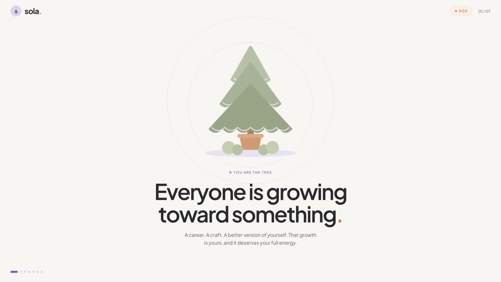

**You are the tree. The small things are ornaments. Grow the tree, and we'll hang the lights.**

Most agents today are blind: they only know what you type or send. Sola **sees**. It understands your life through continuous visual tracks (your fridge, your storage cabinet, your laundry basket, your day) and turns what it sees into help, often before you think to ask.

---

## ⚠️ Two entry points, two branches

Sola is shipped as **two products** that share one design language and one backend design. They live on **separate branches**.

| | 📱 **Mobile app** | 🖥️ **Website** |
| --- | --- | --- |
| What it's for | Easy everyday use: Sola notices, you tap to approve | Deep research for household shopping |
| Where to try it | **Project Demo link:** <https://hazel-wanqi-wang--sola-mobile-web.us-east.modal.run/mobile/> (best on a phone) | **Other Link** <https://hazel-wanqi-wang--sola-web-web.us-east.modal.run/> |
| Code | branch [`hazel`](../../tree/hazel) | branch [`current_world`](../../tree/current_world) |

`main` holds an earlier merge of the two and is **not** the version to judge. See [Code structure](#code-structure) for a file-by-file map of each branch.

---

## Why visual perception matters

| | |
| --- | --- |
| 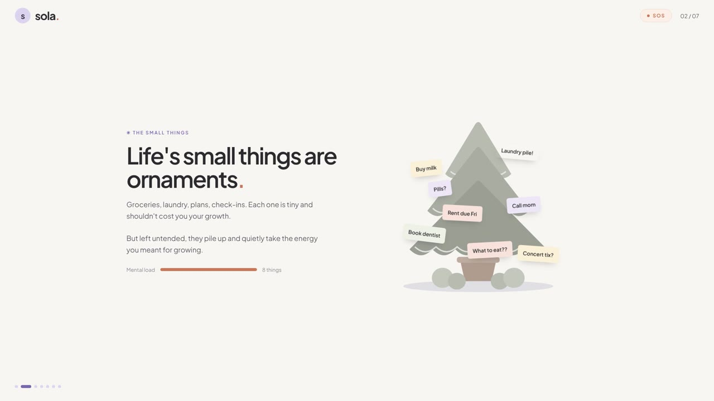 | 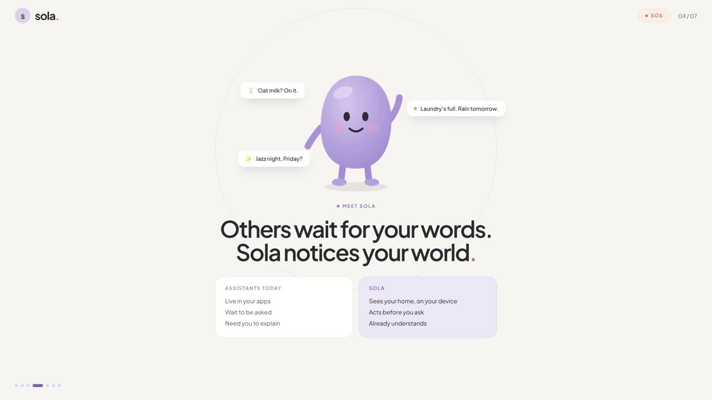 |

Life admin is visual. You *see* that the bread is almost gone, the laundry basket is full, the chair doesn't fit the room, the shoes might not match. Living alone also means nobody else sees how you're really doing. Sola gives your life a second pair of eyes, one that notices, protects, and makes it better.

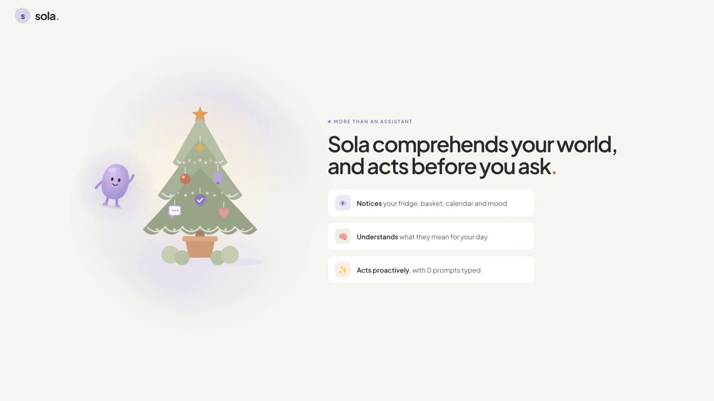

---

## What we built

### 1. The Sola mobile app: a day with Sola

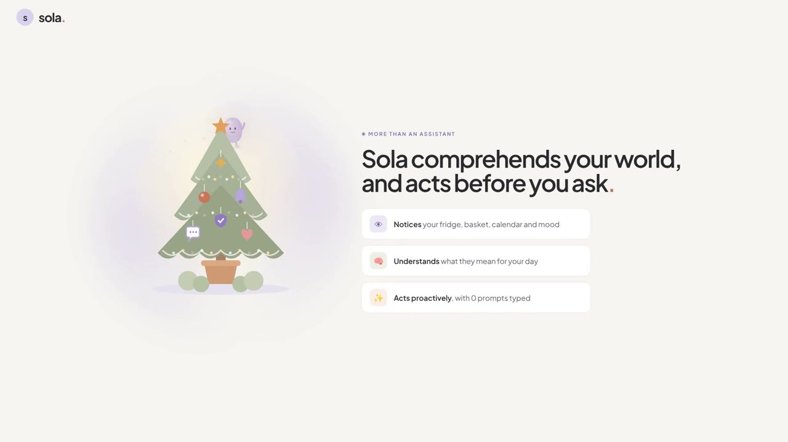

Sola looks at your world and sorts what it notices into three tiers:

- **Handled:** it spots groceries running low and restocks them. It sees a full laundry basket and schedules a reminder.
- **Enriched:** it finds events and plans travel to match your interests. *Chat companionship* gives you a friend who checks in.
- **Protected:** it notices a low day and helps you find the right support for your mental state. Safety features look out for you.

| Shopping: it sees what's running low | Laundry: photos stay on your device | Events & travels: ideas before you ask |
| --- | --- | --- |
| 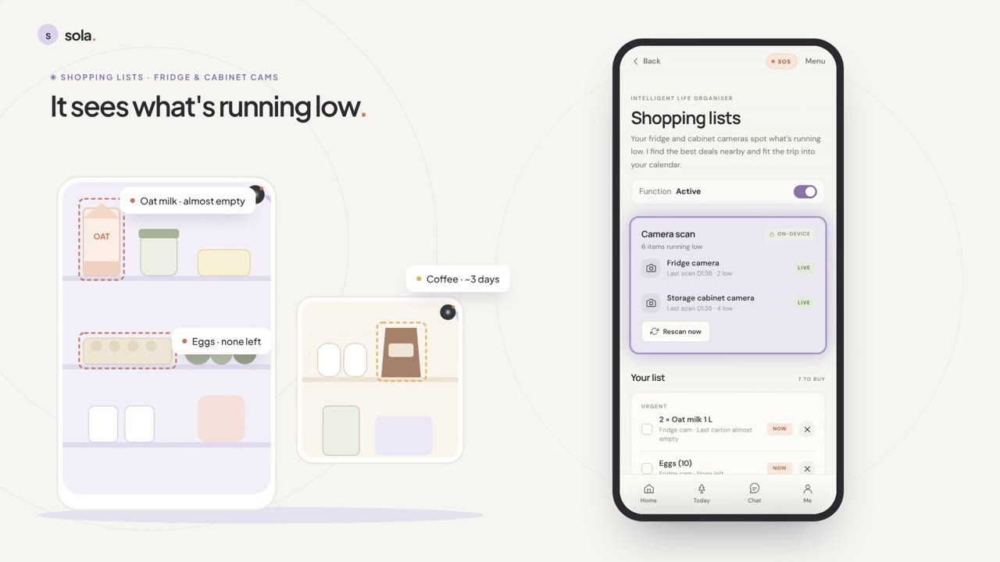 | 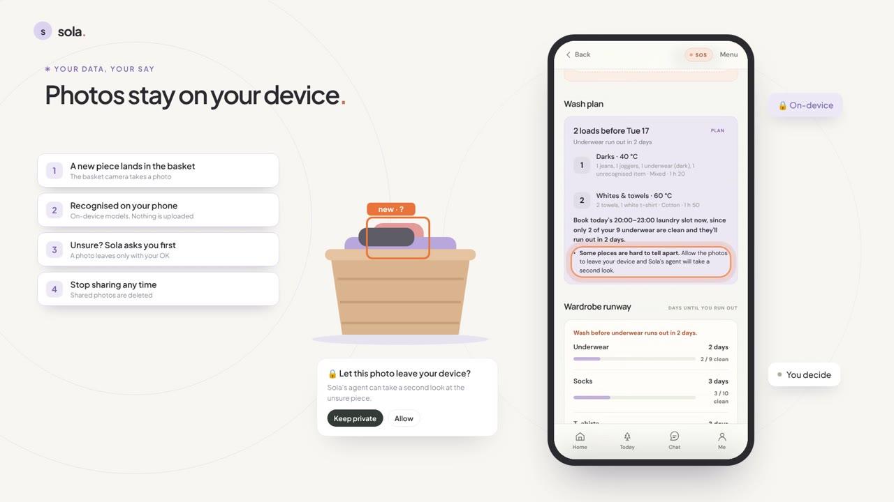 | 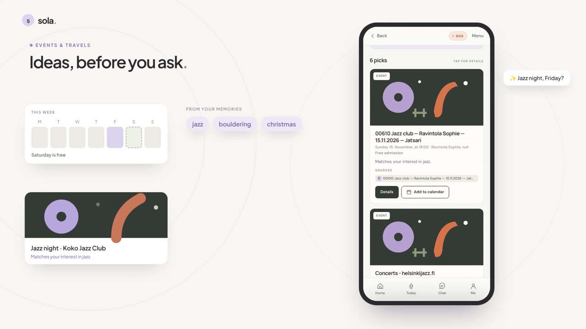 |
| **ChatWithMe: on a low day, someone's there** | **Health & safety: never truly alone** | **Today: just follow the cards, decorate the tree** |
| 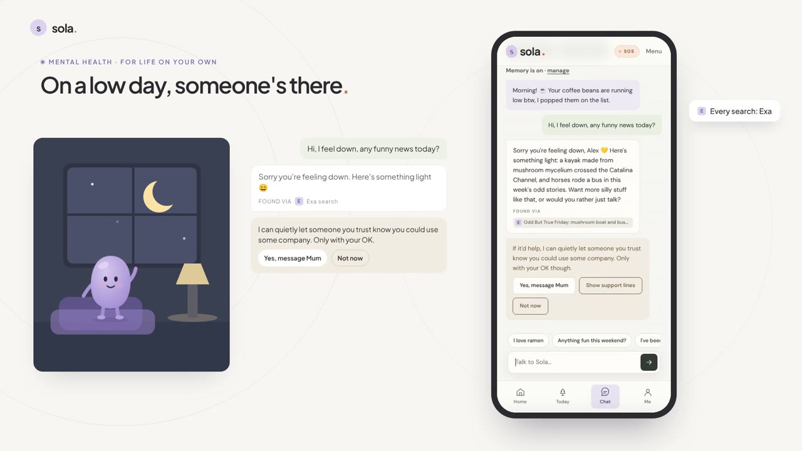 | 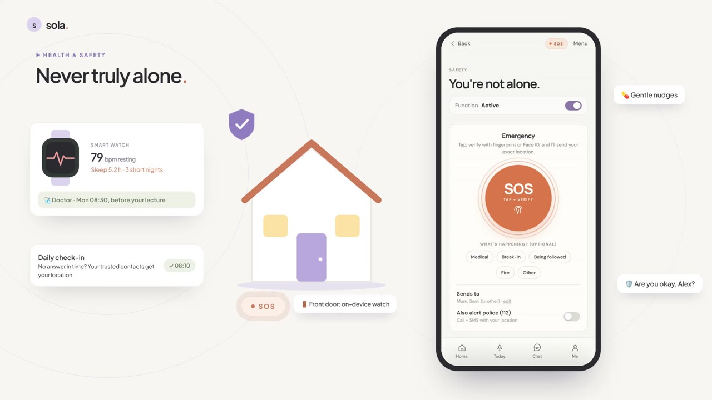 | 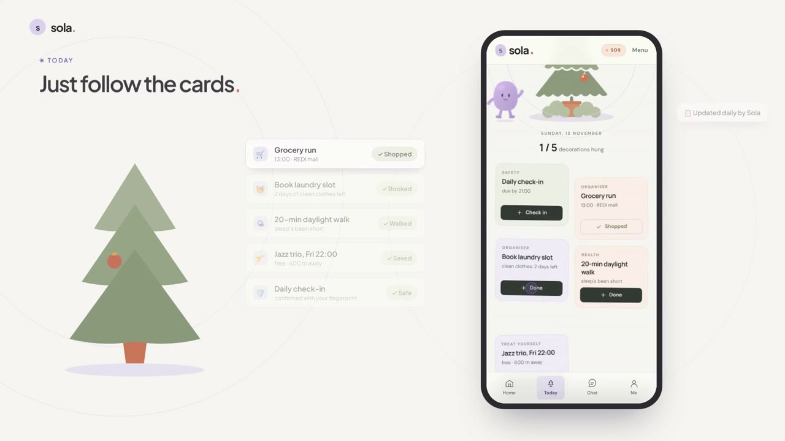 |

Every web search Sola runs uses the **Exa API** and shows its sources. **Nothing is sent or bought without your OK.**

### 2. The Sola web workspace: see it in *your* life before you choose

- **Detailed search:** give specs, a price ceiling, your city, a scope, the sites to check and how often to check them. Sola keeps watching for you.
- **Clean visual results:** Exa-powered results with cleaned product photos, so options are easy to compare.
- **360° view:** product videos rendered as interactive 360° spins with **Cloudinary**.
- **Preview in your space:** Sola sees *you* and *your room*. Try shoes on your own photo, or place a chair in your own room, before you decide.

| Find your thing. Watch its price. | Discovered offers with cleaned photos |
| --- | --- |
| 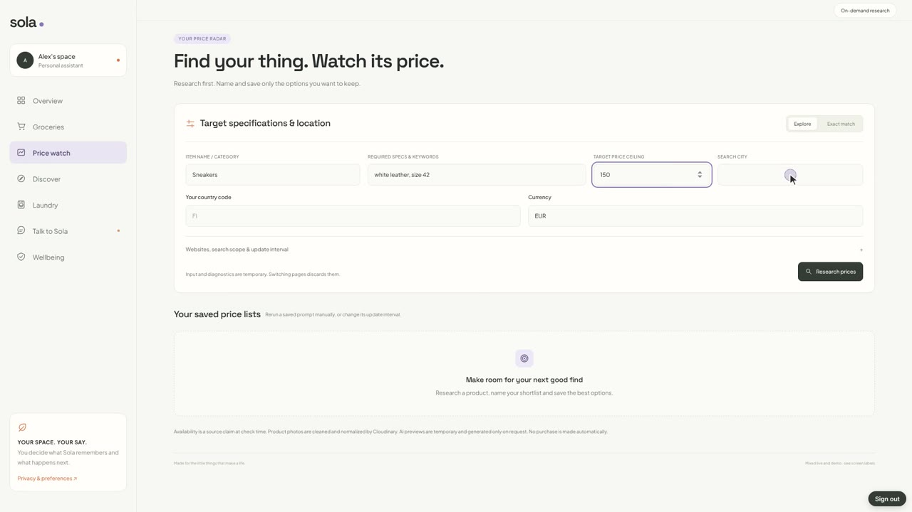 | 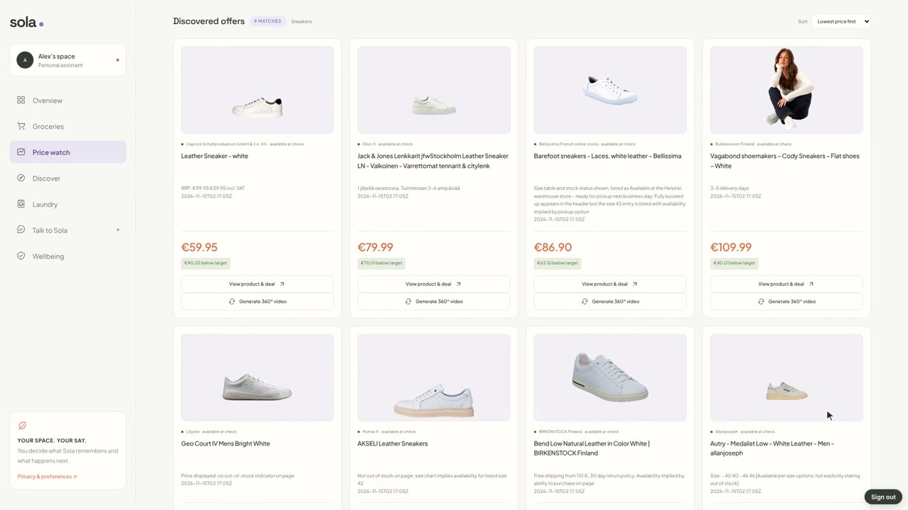 |
| **See every side: 360° video** | **Try it on you** |
| 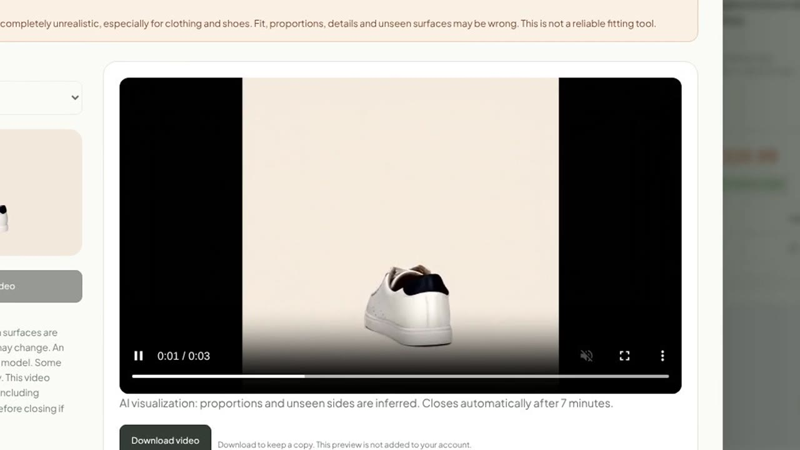 | 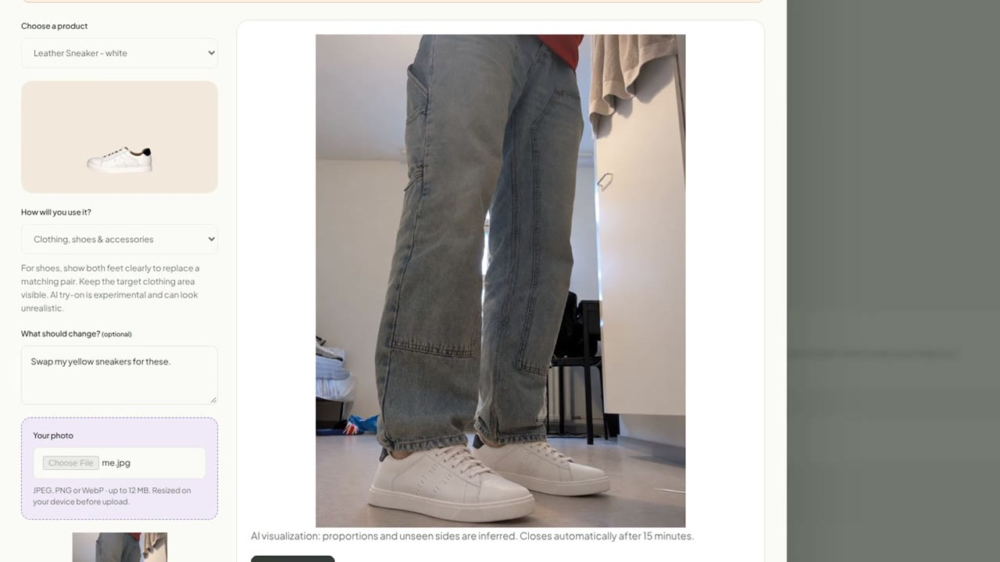 |
| **Place it in your room** | **Life on your own. A little less alone.** |
| 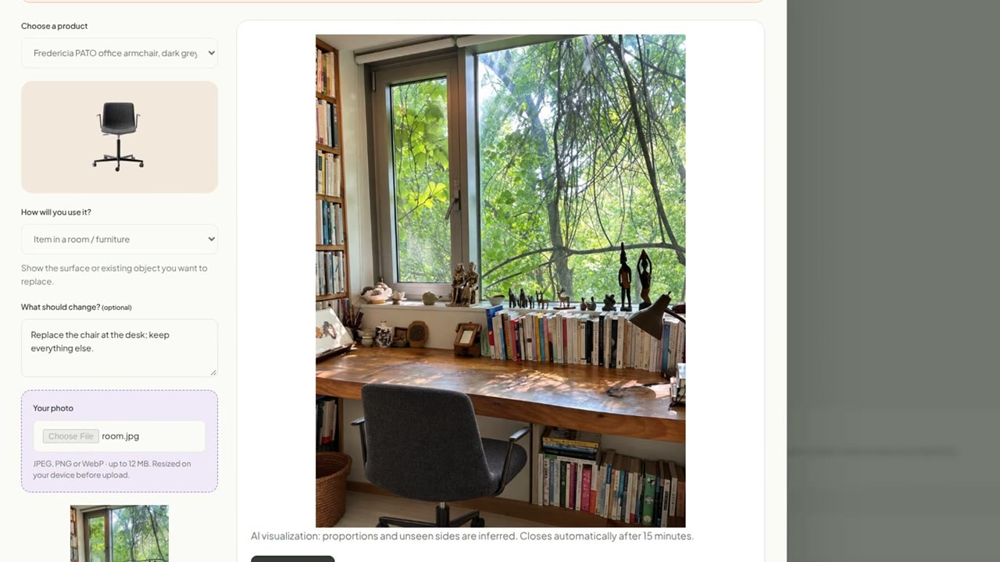 | 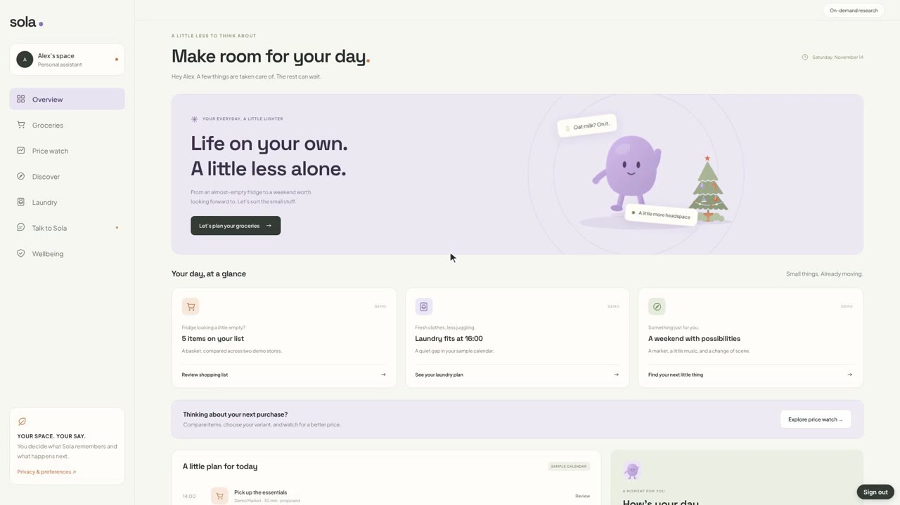 |

---

## Built for everyone, with extra care for people living solo

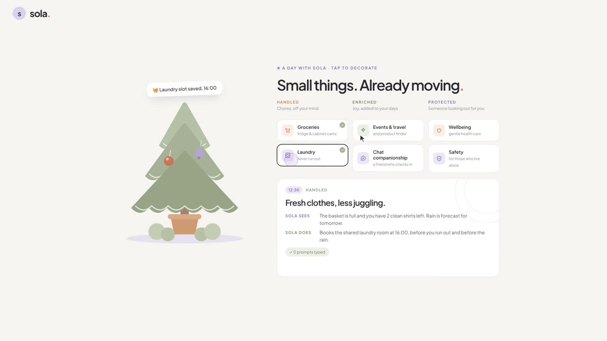

Seeing your life comes with responsibility:

- **Privacy:** your images are processed locally. What Sola sees stays with you.
- **Physical safety:** someone is looking out for you.
- **Peace of mind:** you're never quite alone.

---

## How it works

1. **Perceive:** Sola takes visual input from your photos and surroundings.
2. **Understand:** it builds context about your needs, habits, space and state.
3. **Act proactively:** it searches (Exa), compares and visualises (Cloudinary), then proposes. You approve.

```
camera / photos ──► on-device vision (OWL-ViT + CLIP, in the browser)
                        │  only a summary leaves the device: labels, colours, boxes, a fingerprint
                        ▼
              FastAPI backend ──► Coordinator ──► Researcher (Exa) ──► Planner
                        │                                               │
                        │       Claude: parses requests, writes advice, runs the chat agent
                        ▼                                               ▼
              Cloudinary: cleaned cutouts, 360° video, try-on   proposal card ──► you approve
```

### Tech

- **Visual perception:** images of your life and space are Sola's main input. The laundry-basket camera runs **OWL-ViT B/32** (finds garments) and **CLIP B/32** (names them) locally with transformers.js / ONNX Runtime Web. Pixels leave the device only with explicit consent.
- **Exa API:** the only web search source. Sourced search, structured extraction (price, date, venue) and product discovery.
- **Cloudinary:** background removal for product photos, 360° product video, and short-lived, authenticated try-on previews of you and your room.
- **Claude (Anthropic SDK):** request parsing, laundry advice wording and the chat companion, as a tool-use loop over Sola's own tools. Every caller has a deterministic fallback.
- **Backend:** Python, FastAPI, SQLite. **Frontend:** dependency-free HTML, CSS and ES modules. **Deploy:** Modal (mobile demo), Docker / Compose.

---

## Code structure

Both branches share the same backbone: a FastAPI backend in `backend/`, the website in `index.html` + `src/`, and the mobile app in `mobile/`. Each branch is where one of the two products was finished.

### 📱 `hazel` branch: mobile app

Focus: the phone experience, on-device vision, the chat companion and care features.

```
mobile/                      ← THE MOBILE APP (open /mobile/)
├── index.html               app shell
├── app.js                   screens + hash router: Home · Today · Shopping · Laundry ·
│                            Events & travels · ChatWithMe · Health · Safety · Me;
│                            switch functions on/off; "decorate today's tree"
├── data.js                  demo data for the seeded account
└── styles.css               shared Sola design tokens (lavender, terracotta, sage)

backend/
├── app/
│   ├── main.py              FastAPI app; serves /, /mobile/, /api, /docs
│   ├── llm.py               Claude client + chat-agent tool loop (fallbacks if no key)
│   ├── exa_client.py        budgeted Exa gateway (the only search source)
│   ├── agents/
│   │   ├── coordinator.py   request → validated TaskSpec (no personal data in queries)
│   │   ├── researcher.py    runs Exa searches with JSON-schema extraction
│   │   └── planner.py       turns sourced facts into an approvable proposal
│   ├── services/
│   │   ├── home.py          Home / Today snapshot (tree decorations, full state)
│   │   ├── laundry.py       basket counts + wardrobe runway → wash loads → slot booking
│   │   ├── companion.py     ChatWithMe: Claude agent, memories, crisis-safe support lines
│   │   ├── health.py        wearable vitals, gentle anomaly check-ins, OTC search
│   │   ├── safety.py        check-ins with escalation, SOS, front-door monitoring
│   │   ├── calendar.py · tasks.py · proposals.py · watches.py · treats.py
│   │   └── messaging.py · media.py · organiser.py
│   ├── routers/             account · organiser · research · care · compat (mobile API)
│   └── static/
│       ├── taimi-edge.js         ON-DEVICE VISION: OWL-ViT + CLIP in the browser;
│       │                         sends only a summary + fingerprint, never pixels
│       ├── taimi-laundry-ui.js   laundry camera UI
│       └── laundry-frames/       sample basket photos
├── scripts/fetch_edge_models.sh  downloads the local vision models (git-ignored)
└── tests/                   API, live paths, LLM fallbacks, laundry camera
```

### 🖥️ `current_world` branch: website

Focus: deep shopping research, Cloudinary visuals and production deployment.

```
index.html + src/            ← THE WEBSITE (open /)
├── app.js · ui.js · api-client.js     shell, shared UI pieces, API client
├── live-shopping.js         groceries & shopping: items, attributes, store comparison
├── live-watches.js          "Find your thing. Watch its price.": specs, price ceiling,
│                            city, search scope, sites, check interval
├── search-scope.js          country / EU / multiple / worldwide scope picker
├── product-images.js        cleaned Cloudinary cutouts (retries while they're prepared)
├── preview-api.js           offline website preview with fictional data
├── space-preview.js         "Preview in your space": shoes on you, furniture in your room
├── live-discovery.js        curated events → itinerary builder
├── integrations.js          provider status page (/integrations)
└── styles.css · interface.css · live-shopping.css · art.js (mascot + tree)

backend/app/
├── search_scope.py          validates search market separately from home location
├── services/
│   ├── shopping_prices.py   sourced quotes matched to exact item requirements
│   ├── price_evidence.py    reads prices only as displayed by the source, never guessed
│   ├── product_media.py     Cloudinary background removal (never merchant originals)
│   ├── visual_previews.py   short-lived, authenticated Cloudinary previews + deletion ledger
│   ├── plans.py             research snapshots, multi-search event itineraries
│   └── poster.py            vector itinerary artwork from event facts
├── routers/integrations.py  provider checks
└── (agents/, llm.py, exa_client.py and the other services as on hazel)

Dockerfile · compose.yaml · compose.production.yaml    container deploy
docs/  local-testing · use-cases · api-route-index · deployment · cloudinary-studio
tests/ + backend/tests/      price watch, live views, preview API, shopping prices,
                             visual previews
```

---

## Run it locally

```bash
git checkout hazel            # mobile app   (or: git checkout current_world for the website)
backend/run.sh                # creates .venv, installs deps → http://127.0.0.1:8000
                              # /mobile/ (app) · / (website) · /docs (API)
```

For live data, copy `backend/.env.example` to `backend/.env` and set `EXA_API_KEY`, `CLOUDINARY_URL` and `ANTHROPIC_API_KEY`. Without keys, Sola runs on seeded demo data with deterministic fallbacks. To fetch the on-device vision models (on `hazel`), run `backend/scripts/fetch_edge_models.sh`.

**Honest scope:** real purchases, reservations, rides, outgoing messages and emergency dispatch are **simulated** and labelled as such in the UI. Everything Sola proposes waits for your approval.

---

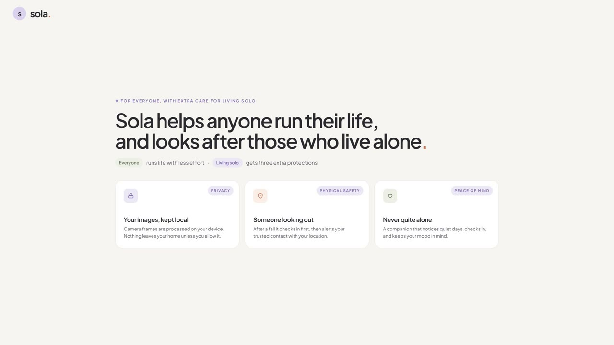

*Sola sees your world. The small things, handled. The big things, yours to grow.*
