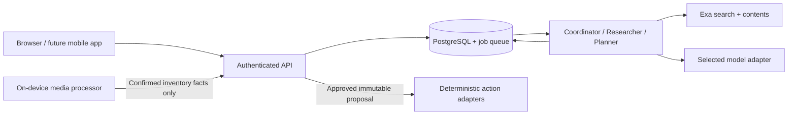

> Runtime update: the backend is Python/FastAPI + SQLite. Account shopping, saved source quotes, generic product details, price refresh and provider checks are implemented. See [local testing](local-testing.md) and [deployment](deployment.md); external actions remain simulations. The TypeScript/PostgreSQL plan below is historical.

# Backend implementation plan

## Proposed stack and boundaries

TypeScript + Fastify for HTTP, PostgreSQL for durable state, and a separate Node worker for long-running research. Use schema validation at HTTP and model-output boundaries. Start with PostgreSQL-backed jobs and `FOR UPDATE SKIP LOCKED`; Redis is unnecessary for the hackathon. Pin dependencies and provider model versions when creating the backend.

Suggested future paths: `backend/src/routes`, `domain`, `agents`, `providers/exa`, `providers/models`, `actions`, `jobs`, `db/migrations`, and `schemas`. These paths are not implemented yet.

## Service responsibilities

- Identity: verified user session, tenant ownership, consent records and encrypted integration credentials.
- Inventory: manual items and confirmed device observations, including units and provenance.
- Task runner: typed input, budgets, three bounded agents, retries, cancellation and progress events.
- Evidence: normalized sources and claim-source mapping, freshness policy and failed retrieval records.
- Proposals: deterministic totals, versioning, expiration and constraint validation.
- Actions: approval checks, idempotency and provider-specific delivery/reconciliation. These are ordinary functions, not a fourth agent.

## Task lifecycle

`queued → clarifying | researching → planning → awaiting_approval → completed`

Any active state may become `cancelled` or `failed`. `partial` means useful research exists but a complete plan cannot be made. Saving a printable plan completes an MVP task without an external action. Research does not wait for approval; material actions do.

The Coordinator emits a structured clarification only when a hard constraint is missing. Persist the answer and resume the same task rather than silently replacing user intent. A job lease, attempt count and heartbeat allow recovery after worker crashes. Cancellation must be checked between provider calls.

## Approval and execution

1. Planner returns a draft; server recalculates quantities/totals, validates sources and creates immutable proposal version N.
2. Client renders N, showing full scope, exclusions, applicable evidence and expiry.
3. Approval transaction verifies ownership, consent, N's hash and validity, then inserts approval + action + outbox job atomically.
4. Worker checks prerequisites again. A changed price, time, contact or item requires a new version and approval.
5. Execute only allowlisted operations through authenticated adapters. Stable idempotency key is derived from user, proposal version and action type.
6. Record provider reference and outcome. A timeout after submission becomes `unknown`, not automatically failed; reconcile before retry to avoid duplicate orders.

The MVP's only action is saving/exporting a plan. Actual checkout, calendar writes and laundry bookings must wait until adapters and test environments exist.

## Research and cost control

Use bounded Exa queries described in [agents](exa-agents.md). Keep keys on the server. Limit page content length, tool arguments and output size. Cache general public content, but isolate user-specific results. Re-fetch price-sensitive evidence before presenting a final quote. Keep an observable per-task cost/usage ledger; record provider-reported usage and compute charges from configured prices rather than hard-coded assumptions.

Set connection and total timeouts. Retry network/429/5xx errors at most twice with exponential backoff and jitter, honoring `Retry-After`; never retry authentication errors blindly. Budget exhaustion returns partial results with reasons. Hosted pages are untrusted data: ignore embedded instructions and never let a page choose tool permissions.

## Deployment and operations

Deploy static UI separately from API and worker. Use same-site session cookies where possible; otherwise explicit CORS allowlist and CSRF controls. Provision PostgreSQL, apply migrations as a release step, configure server-only keys and encrypted integration secrets. Run health/readiness endpoints, structured logs with task IDs, and metrics for latency, retrieval failure, unsupported claims and action delivery.

Development, staging and production use separate provider keys/databases. Backups and restore must be tested before storing real personal data. Do not log chat bodies, camera facts or precise location by default. See [privacy](privacy-security.md) for retention and deletion requirements.

## General price monitoring

The [Price watch specification](price-watch.md) extends the same three agents to arbitrary items and exact variants. A deterministic scheduler owns recurring jobs and alert evaluation; there is no fourth agent. Current frontend checks are simulations, not live jobs.

## Current pricing, research persistence and media

The Python services now validate display-price text and package/item basis in `price_evidence.py`, research each selected grocery domain separately, and support explicit nearby-retailer discovery. Watches require availability evidence and preserve multiple options. `plans.py` stores research snapshots and account-owned event/trip plans, validates source ownership and limits event preview generation to three events per plan. Cloudinary generation uses the Python SDK, with product-page JSON-LD/Open Graph image extraction on request. See [workflow, configuration and API details](media-and-trips.md).

Latest behaviour: [manual grocery pricing, strict attributes, temporary research and named lists](current-behavior.md). This supersedes earlier automatic-lookup and restored-research descriptions.

## Cloudinary product studio update

[Current implementation and use cases](cloudinary-studio.md): list-level environment previews from one app-found product and one uploaded photo, download-only temporary results, cleaned transparent product photos, and AI-generated 45° left/right three-second object turns. Room media is private and cleaned up on close/expiry; public product cutouts are cached. Generation requires Cloudinary add-on access and is tested with mocked APIs only.
