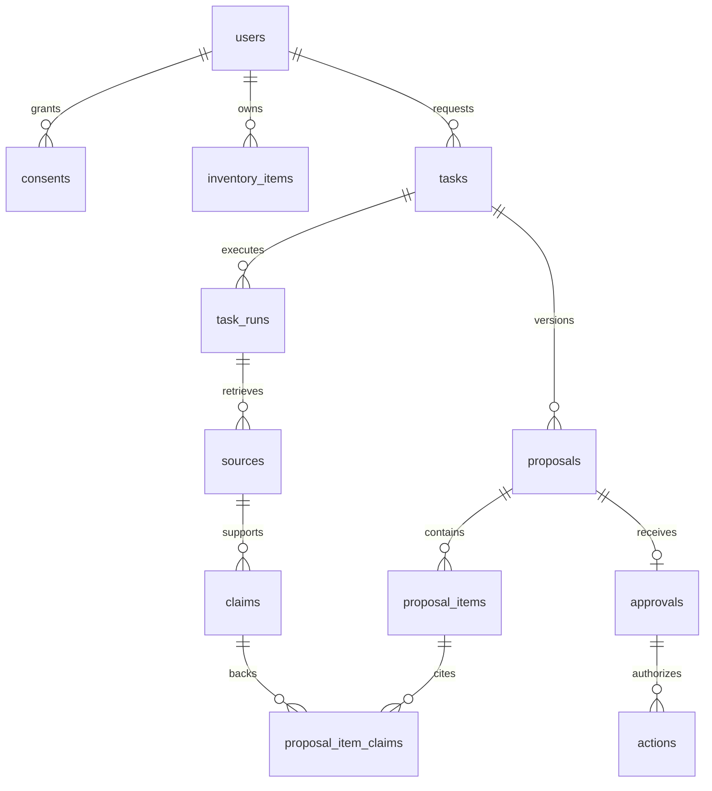

> Runtime update: SQLite in `backend/data/taimi.sqlite3` is the current database; PostgreSQL below is a proposal. Actual schema is in `backend/app/db.py`, with additive migrations for brand/details/attributes, shopping_quotes and shopping_refreshes. Quotes bind to user, exact identity and explicit search context. No database server is needed.

# Database structure

Proposed PostgreSQL schema; this specification is not a migration and no database is provisioned. Use UUID primary keys, `timestamptz` in UTC, `created_at` and `updated_at` on mutable tables. Application timezone is an IANA value such as `Europe/Helsinki`, used for display and recurrence evaluation.

## Relationships

## Core tables

| Table | Main columns and constraints |
| --- | --- |
| `users` | `id`, `auth_subject UNIQUE`, `display_name`, `timezone`, `locale`, `currency`, `deleted_at` |
| `preferences` | `user_id PK/FK`, `city`, `dietary_rules jsonb`, `budget_minor bigint CHECK >=0`, `preferred_stores jsonb`, `travel_limit_minutes` |
| `consents` | `id`, `user_id`, `scope`, `policy_version`, `granted_at`, `revoked_at`; one active record per user/scope |
| `inventory_items` | `id`, `user_id`, `name`, `quantity numeric CHECK >=0`, `unit`, `low_threshold numeric`, `priority`, `origin manual/device`, `confirmed_at`, `version int` |
| `inventory_observations` | `id`, `user_id`, `item_id`, `device_id`, `observed_quantity`, `confidence numeric CHECK 0..1`, `observed_at`, `confirmed_at`; no media blob |
| `shopping_lists` | `id`, `user_id`, `title`, `status active/archived` |
| `shopping_items` | `id`, `user_id`, `list_id`, `inventory_item_id NULL`, `name`, `quantity numeric CHECK >0`, `unit`, `priority`, `bought_at`, `version` |
| `tasks` | `id`, `user_id`, `intent`, `request_text`, `constraints jsonb`, `status`, `clarification jsonb NULL`, `version`, `cancelled_at` |
| `task_runs` | `id`, `user_id`, `task_id`, `attempt`, `state`, `started_at`, `finished_at`, `usage jsonb`, `error_code`, `summary`; UNIQUE(task_id, attempt) |
| `agent_steps` | `id`, `user_id`, `run_id`, `role coordinator/researcher/planner`, `sequence`, `status`, `input_hash`, `output jsonb`, `duration_ms`; no hidden reasoning |
| `sources` | `id`, `user_id`, `run_id`, `url`, `canonical_url`, `title`, `domain`, `fetched_at`, `published_at NULL`, `expires_at`, `excerpt`, `content_hash`, `provider_request_id`, `retrieval_status` |
| `claims` | `id`, `user_id`, `source_id`, `kind price/time/availability/description`, `value jsonb`, `evidence_excerpt`, `verification unverified/supported/conflicting/stale`, `applicable_location` |
| `proposals` | `id`, `user_id`, `task_id`, `version`, `kind`, `status`, `payload jsonb`, `payload_hash`, `known_subtotal_minor bigint`, `currency char(3)`, `has_unknown_costs bool`, `expires_at`; UNIQUE(task_id, version) |
| `proposal_items` | `id`, `user_id`, `proposal_id`, `shopping_item_id NULL`, `label`, `quantity numeric`, `unit`, `unit_price_minor bigint NULL`, `line_total_minor bigint NULL`, `retailer`, `unknown_reason NULL` |
| `proposal_item_claims` | `user_id`, `proposal_item_id`, `claim_id`; composite PK on item/claim; links several evidence claims to one item |
| `approvals` | `id`, `user_id`, `proposal_id UNIQUE`, `proposal_hash`, `approved_at`, `revoked_at`; immutable approval evidence |
| `actions` | `id`, `user_id`, `approval_id`, `type`, `status pending/running/succeeded/failed/unknown/cancelled`, `idempotency_key UNIQUE`, `provider_reference NULL`, `result jsonb`, `executed_at` |
| `jobs` | `id`, `user_id`, `task_id NULL`, `action_id NULL`, `type`, `payload jsonb`, `state`, `attempts`, `available_at`, `lease_until`, `worker_id`; CHECK exactly one task/action target |
| `audit_events` | `id`, `user_id`, `entity_type`, `entity_id`, `event_type`, `redacted_metadata jsonb`, `created_at`; append-only |

Do not use floats for money. SQL `NULL` means an unknown price; zero is a known free item. The UI's fixture-only `[0,0]` price convention must not cross into the backend. Store amounts in the currency's minor units, with an explicit currency exponent policy; MVP supports EUR only. Validate unit conversions outside the model.

## Later feature tables

| Table | Purpose |
| --- | --- |
| `calendar_connections` | Encrypted OAuth reference, scopes, sync cursor; never plaintext tokens |
| `calendar_blocks` | User-owned busy interval, timezone, external ID; store minimum necessary detail |
| `laundry_plans` | Proposal reference, proposed start/end, machine reference, reservation status |
| `saved_discoveries` | User, source/proposal reference and saved timestamp |
| `chat_threads`, `chat_messages` | User ownership, role, text, retention date; opt-in persistence |
| `memories` | User-confirmed fact, consent ID, provenance, expiry and deletion state |
| `trusted_contacts` | Verified destination, contact consent, channel and verification time |
| `checkins` | User, due time, confirmed time, challenge verification state |
| `escalation_rules` | Explicit consent, grace window, recipient set, cancellation and delivery policy |

Do not create location history or video tables by default. Add such storage only with a defined feature, explicit consent and a short retention policy.

## Ownership, indexes and concurrency

Every user-owned row carries `user_id`. Enable row-level security and scope all API queries to the authenticated subject. Service workers use a restricted role and explicit user context. Enforce composite foreign keys `(user_id, parent_id)` referencing `(user_id, id)` so a child cannot attach to another user's record. Add those composite unique keys on all referenced parent tables.

Recommended indexes: `tasks(user_id, created_at DESC)`, `shopping_items(user_id,list_id,bought_at)`, `sources(user_id,run_id)`, `sources(canonical_url, fetched_at DESC)`, `proposals(user_id,task_id,version DESC)`, and partial `jobs(available_at) WHERE state='queued'`. Add UNIQUE `(user_id,scope) WHERE revoked_at IS NULL` for active consents. Constrain all status values with enums or CHECKs.

Create proposal revision and invalidate the old revision in one transaction. Approval locks the proposal row, checks expected version/hash and expiry, then inserts approval and action job atomically. Use optimistic version checks for list edits. Deletion revokes active jobs first, removes personal rows and content caches, then retains only legally required minimized audit records under a documented policy.

## Migration sequence

001 users/preferences/consents → 002 inventory/lists → 003 tasks/runs/steps/jobs → 004 sources/claims → 005 proposals/items/approvals/actions → 006 audit/RLS/indexes. Seed only fictional demo records. Test cross-user access, transactional approval and backup restore before connecting real accounts.

## Product and price-watch extension

See [Price watch database additions](price-watch.md#proposed-database-additions) for canonical products/variants, seller offers, append-only price observations, user-owned watches, scheduled checks and deduplicated alerts. These additions are not yet migrations.

## Current saved research and itinerary storage

SQLite now also creates `research_searches(id,user_id,query,kind,payload,created_at)` and `saved_itineraries(id,user_id,payload,created_at,updated_at)` with user/time indexes. Their JSON snapshots preserve source event dates/times, price text, image URLs and generated media. Price watch JSON preserves lastOffers, savedOptions and pricingVersion; existing price_observations now store all qualifying options per check (up to ten), not just the best. New grocery context hashes include pricingVersion=2 so old, unvalidated quotes do not silently reappear. Historical rows are retained; they are not blindly rescaled. Generated assets remain in media_assets. See [the workflow](media-and-trips.md).

## Cloudinary product media tables (implemented SQLite)

`product_image_cache(id PRIMARY KEY, source, asset_id, clean_asset_id)` maps public source URLs to reusable uploaded product images and cleaned product assets. The UI receives the same-origin cleaned-photo endpoint, never an original-image fallback.

`visual_sessions(id PRIMARY KEY, user_id, kind, status, expires, purge_after, cancelled, room_id, result_id, result_type, preset, provider_job, error, cleanup_after)` is a temporary ownership/deletion ledger. No room bytes, base64, generated URLs or prompt snapshots are stored. Ready sessions expire after 15 minutes. Successful closed-session cleanup removes the row; failed/interrupted identifiers remain for late-result cleanup and provider retries. This is separate from permanent event `media_assets`. Additive migrations run automatically; no separate database server is needed. See [lifecycle](cloudinary-studio.md#persistence-and-deletion).
